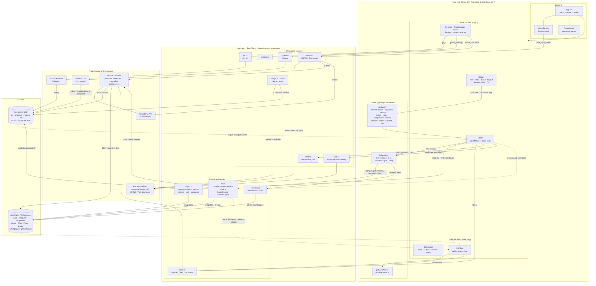

# Lexy

**A calm, Word-like LaTeX writer for Windows.** Lexy installs the TeX tools it needs, compiles while you type, and keeps your projects as plain folders that also work in TeXstudio, VS Code or Overleaf.

> [!IMPORTANT]
> **I won't work on this project anymore.** Building Lexy with Claude ate my whole context budget, so this is where I stop. If you want to take it further, fork it and carry on yourself, or gift me a Claude plan and I might come back 😂😂😂
> Everything you need to continue is written down: [`docs/ROADMAP.md`](docs/ROADMAP.md) (unfinished work, release blockers, optimizations) and [`CLAUDE.md`](CLAUDE.md) (an architecture map).

> **Status: alpha (v0.1.0-alpha.1).** Feature-complete for its first eight specs and covered by automated tests, but hardly anyone has tried it in a real window or on a fresh PC yet. Expect rough edges.

## Try the alpha

For enthusiasts who want to poke at it:

1. Download the installer from [**Releases → v0.1.0-alpha.1**](https://github.com/abusayed0206/lexy/releases/tag/v0.1.0-alpha.1): `Lexy_0.1.0_x64-setup.exe` (NSIS, per-user) or `Lexy_0.1.0_x64_en-US.msi`.
2. The installer is **not code-signed**, so Windows SmartScreen will warn you. Choose **More info → Run anyway** if you trust this repository.
3. On first start, Lexy offers to install MiKTeX and a portable Strawberry Perl (per user, no admin, with visible progress). This needs an internet connection and a few hundred MB.
4. Create a project from a template and start typing. The PDF updates as you write.

Known limits of this alpha:
- Windows 10/11 x64 only.
- The MiKTeX setup download is not hash-pinned yet.
- No auto-update.
- Several features were only tested automatically, never by hand (see the roadmap).

Bug reports are welcome as GitHub issues, but nobody is actively fixing them right now.

## Highlights

- **Ribbon instead of commands.** File, Home, Insert, Layout, View and Git tabs. Bold, headings, lists, footnotes, tables (grid picker), equations (palette with live math preview), fonts, paper, margins and orientation. Every ribbon action is one undo step, and page settings live in one marked block in your `.tex`.
- **Live preview.** Compiles about a second after you stop typing, in the background. The PDF updates without losing your zoom or scroll position, and if a compile fails the last good PDF stays visible.
- **Jump between PDF and source.** Double-click the PDF to go to the line that produced it, even in a chapter file. Press **Ctrl+J** to see the cursor's line in the PDF.
- **Readable errors.** Errors and warnings appear inline in the editor and in a Problems list. Click one to open the file at that line.
- **Projects are folders.** A file sidebar, a main document per project, multi-file documents (`\input`, `\include`, images, `.bib`), drag-and-drop from Explorer, and deletes that go to the Recycle Bin. Lexy never writes its own state into your project.
- **Bangla and other scripts.** Bangla text compiles even without any font setup: Lexy picks XeLaTeX and a Bangla-capable font automatically, with correct conjuncts. One click adds **BCC Purno** to the project so it compiles anywhere. The font menu lists the whole free **[kriti.app](https://kriti.app)** Bangla catalog (each font is copied into the project). The editor shows Bangla in a bundled font, with Windows-like cursor movement over conjuncts, and right-to-left lines read correctly.
- **Version history with Git.** Start history, commit, see line-by-line changes, browse and restore old versions, publish to GitHub, push, pull and resolve conflicts. Lexy uses your Git for Windows; sign-in goes through Git's own credential manager and never through Lexy.
- **Zero-setup TeX.** On first run Lexy installs MiKTeX (per user, no admin) and a portable Strawberry Perl for `latexmk`, with visible progress. Missing LaTeX packages are installed on the fly during a compile.
- **Writing aids.** Suggestions for commands, labels, citations and environments; `\begin` closes itself; offline spell check; optional grammar check (LanguageTool); word count; math preview on hover; one-key tidy.
- **Navigation.** Outline, editor tabs, folding, a command palette (Ctrl+Shift+P), find and replace across the project, focus mode and optional Vim keys.
- **Content and review.** Citation picker and "Add by DOI", images by drag-and-drop, a template gallery, notes on text (with a "PDF with notes" export), and word-level comparison with an earlier version.
- **Safety.** Unsaved text survives a crash (it is offered back when you reopen the project), a Stop button for a stuck compile (Shift+F5), local snapshots for projects without Git, and optional auto-save.
- **Control.** Pick the TeX engine (Automatic, pdfLaTeX, XeLaTeX, LuaLaTeX) from the ribbon, find text in the PDF preview (Ctrl+F), and export to Word or HTML (Pandoc is downloaded only with your consent).
- **Light and dark themes**, Windows contrast themes, keyboard shortcuts for everything, and a layout that works at 800×600.

## Keyboard shortcuts

| Action | Keys |
|---|---|
| Compile now / Stop compile | F5 / Shift+F5 |
| Command palette | Ctrl+Shift+P |
| Find in the PDF (preview focused) | Ctrl+F, then Enter / Shift+Enter, Esc |
| Find and replace in the project | Ctrl+Shift+F |
| Check grammar | F7 |
| New note on the selection | Ctrl+Alt+M |
| Focus mode / Settings | F11 / Ctrl+, |
| Save all / Save as | Ctrl+S / Ctrl+Shift+S |
| New file / Open folder | Ctrl+N / Ctrl+O |
| Bold / Italic / Underline | Ctrl+B / Ctrl+I / Ctrl+U |
| Show the cursor's line in the PDF | Ctrl+J |
| PDF zoom in / out / fit (preview focused) | Ctrl+= / Ctrl+- / Ctrl+0, or Ctrl+wheel |
| Show logs | Ctrl+L |
| Files sidebar | Ctrl+Shift+E |
| Git panel / commit message | Ctrl+Shift+G / Ctrl+Shift+K (Ctrl+Enter commits) |

## Run from source

Requirements: Windows 10 or 11, [Node.js](https://nodejs.org) 20+, [Rust](https://rustup.rs) (stable, MSVC toolchain) and the [Tauri prerequisites](https://tauri.app/start/prerequisites/) (WebView2 ships with Windows 11). For the Git features you also need [Git for Windows](https://git-scm.com/download/win); [GitHub CLI](https://cli.github.com) is only needed for "Publish to GitHub".

```powershell
npm install
npm run tauri dev
```

The first start runs Lexy's setup screen, which installs MiKTeX and Strawberry Perl if they are missing.

Build an installer locally:

```powershell
npm run tauri build
```

## Tests

```powershell
npm test                       # frontend (Vitest)
npm run build                  # type check + production build
cd src-tauri; cargo test       # backend (Rust)
```

Some Rust tests run real compiles with MiKTeX, `latexmk` and Perl, and skip themselves ("skipping") on machines without them. The font tests download from kriti.app; set `LEXY_OFFLINE=1` to skip those without a network.

## How it works

Lexy is a [Tauri 2](https://tauri.app) app: a React 19 + TypeScript front end (CodeMirror 6 editor, pdf.js preview) and a Rust back end that owns everything that touches files or runs programs.



*Solid arrows are requests and writes; dotted arrows bring results back to the screen. React only presents: every arrow out of the front end is a typed `invoke` command. Rust owns the disk, the processes and the network, and it writes into your project only for Save, fonts you add, exports you ask for and notes.*

**What happens when you type:** the editor keeps your text in memory. A second after you pause, `livePreview.ts` asks Rust to compile the main document plus every unsaved file. Rust writes those into the build folder (never your project), runs `latexmk`, keeps the last good PDF and its SyncTeX data, and returns problems that show inline. Two seconds after you pause, `recovery.ts` also stores your unsaved text under `%LOCALAPPDATA%\Lexy\Recovery`, so a crash loses nothing. Stop (Shift+F5) kills the whole latexmk process tree.

*Compiles read your project but write only into the build folder, where the last good PDF and its SyncTeX data are kept; a failed compile never overwrites them.*

- **Compiling never touches your files.** The main document is written to a snapshot in `%LOCALAPPDATA%\Lexy\Build\…`, unsaved open files go into an overlay folder that TeX searches first, and everything else (chapters, images, `.bib`, fonts) is read straight from the project. `latexmk` runs with pdfLaTeX, or XeLaTeX when the document needs it (a `% !TEX program` line, packages like `fontspec`/`polyglossia`/`latexbangla`, or Bangla text). Every compile also writes SyncTeX data for the PDF ↔ source jumps.
- **Paths are checked in one place.** Every file command takes a project-relative path and goes through one gate that refuses `..`, other drives, reserved names and links that lead out of the project.
- **Downloads are verified.** Setup tools and BCC Purno are downloaded from fixed versions with pinned SHA-256 hashes. kriti.app catalog fonts come only from `https://kriti.app/fonts/…` and must be real font files.

More detail lives in the docs:

- [`docs/PLAN.md`](docs/PLAN.md): architecture, milestones and engineering rules
- [`docs/DESIGN.md`](docs/DESIGN.md): UI rules
- [`docs/SETUP.md`](docs/SETUP.md): how the first-run install works
- [`docs/TRACKER.md`](docs/TRACKER.md): feature status, decisions and test runs
- [`docs/ROADMAP.md`](docs/ROADMAP.md): what's unfinished, release blockers, optimizations (start here if you continue the project)
- [`specs/`](specs/): one folder per feature (spec, plan, research, tasks)
- [`CLAUDE.md`](CLAUDE.md): a compact architecture guide for contributors and coding agents

## Contributing

The original author no longer works on Lexy; forks are the way forward. [`docs/ROADMAP.md`](docs/ROADMAP.md) lists what to do next. Ideas go into the "Manual Feature Intake" table in `docs/TRACKER.md` first. Each feature gets a spec under `specs/`, and `docs/TRACKER.md` is updated in the same change that implements it. Run the three test commands above before sending a change.

## Fonts and third-party notices

- **BCC Purno** (Bangladesh Computer Council, EBLICT project) is bundled for showing Bangla in the editor (`src/assets/fonts/`) and is copied into projects when you choose it. Its notice file names the source; the license is the Bangladesh Computer Council's.
- Fonts from the **kriti.app** catalog are downloaded only when you pick one, and each project gets a notice file with the font's designer, license and source link.
- MiKTeX, Strawberry Perl, Git and GitHub CLI are installed or used as separate programs under their own licenses.

## License

Lexy is free software under the **GNU General Public License v3.0 or later** ([`LICENSE`](LICENSE)), copyright © 2026 MD. ABU SAYED.

In short: you may use, study, change and share Lexy. If you distribute Lexy or a modified version, you must keep the copyright and license notices (credit the original project), release your complete source code under the same license, and state what you changed. See [`LICENSE`](LICENSE) for the exact terms.

Third-party fonts and tools keep their own licenses (see "Fonts and third-party notices" above); the bundled BCC Purno font is not covered by the GPL.
